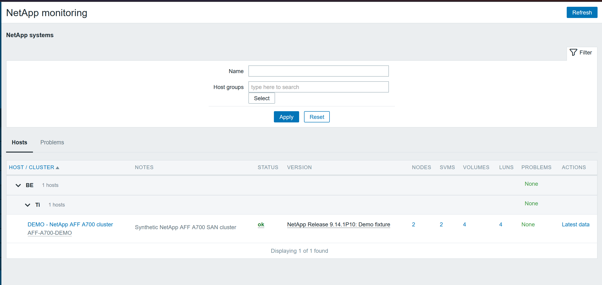
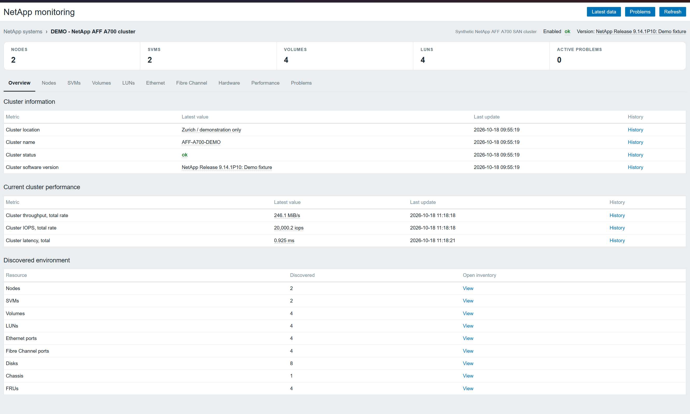
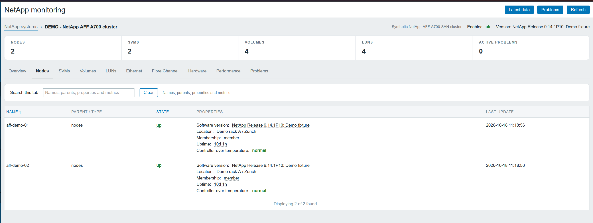
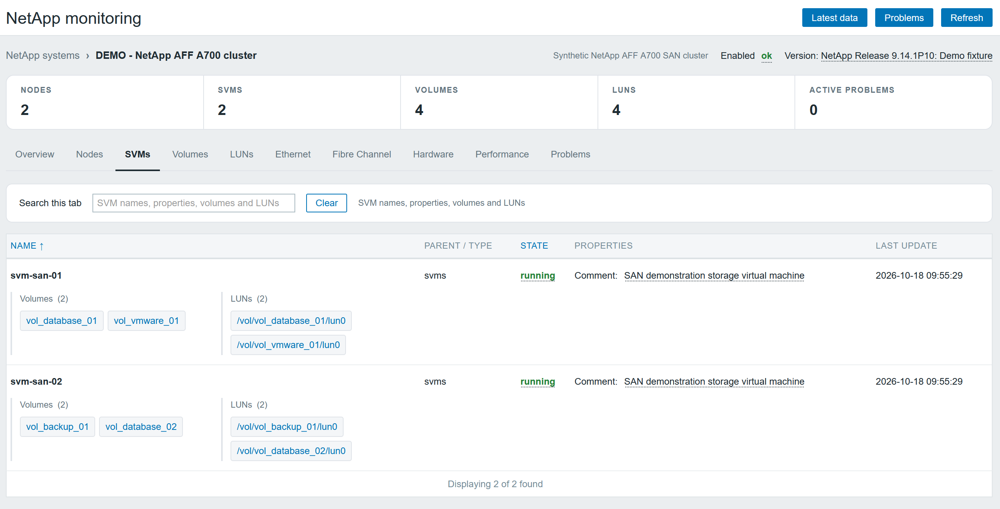
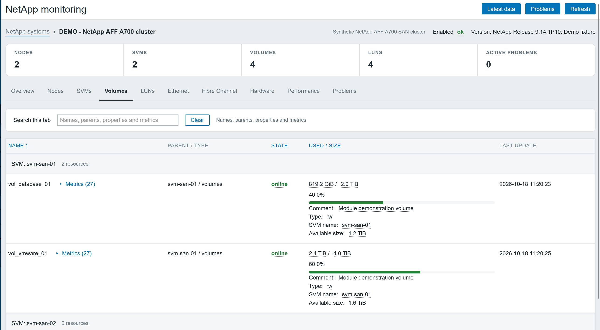
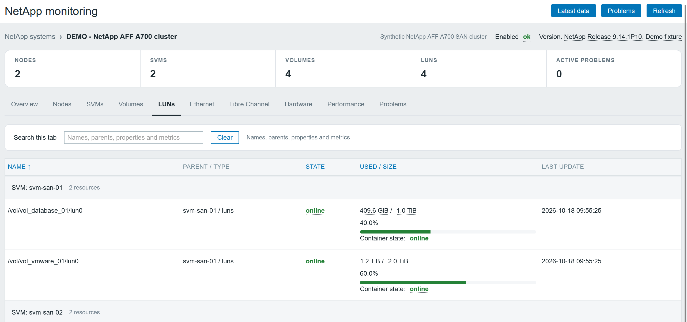

# NetApp Monitoring for Zabbix 7.0

A standalone frontend module for NetApp AFF A700 clusters monitored with
`template_san_netapp_aff_a700_http.yaml`. It reads existing Zabbix data to show cluster health,
capacity, performance, discovered resources, and problems. The module requires no direct
NetApp connection, separate credentials, build step, or database changes.

The main inventory uses the shared **Auto-refresh** checkbox, off by default.
Enable it to refresh the current tab, filters, sorting and page at your Zabbix
refresh interval (minimum 10 seconds; 60 seconds if disabled in preferences).
Hidden pages and open Zabbix popups pause polling; failed refreshes retain the
last loaded results. **Refresh** still works manually.

## Installation

1. Configure the supplied monitoring template in Zabbix, link it to your NetApp hosts, and
   allow discovery and data collection to complete. The module does not import the template.
2. Copy the module into the Zabbix frontend's `modules/netapp_monitoring` directory
   (commonly `/usr/share/zabbix/modules/netapp_monitoring`). Runtime files are `manifest.json`,
   `Module.php`, `actions/`, `includes/`, `views/`, and `assets/`.
3. Give the web server read access to those files.
4. Open **Administration → General → Modules**, select **Scan directory**, and enable
   **NetApp Monitoring**.
5. Open **Monitoring → NetApp**.

## Host eligibility and permissions

Hosts must use a template whose visible or technical name contains `NetApp AFF A700 by HTTP`.
Prefixed names such as `stp - NetApp AFF A700 by HTTP` and inheritance through wrapper templates
are supported. Matching item keys alone do not qualify a host.

The signed-in user needs access to **Monitoring → Latest data**, permission to use the module,
and read access to the host and its matching templates. Template-group permissions apply
independently of host permissions. Hosts whose template eligibility cannot be verified are
excluded, including when their host ID is entered directly in a URL.

Monitoring data is read through the user's Zabbix API permissions. Native item, host, and
problem menus expose only the actions allowed by that user's role and object permissions.

## Hosts and problems

The main page has **Hosts** and **Problems** tabs with shared Name and host-group filters.
Name searches visible host names, technical names, and host inventory notes. Host-group
selection includes accessible descendants. Problems cover all matching hosts, including those
beyond the current Hosts page.

As on the VMware main page, a summary above the tabs shows **NetApp clusters**, **NetApp nodes**,
**SVMs**, and **Volumes**. The counters cover all accessible clusters matching the current Name
and host-group filters, across every table page. They load asynchronously with the table and
update together on search, navigation, and Refresh. Unavailable resource counts are labelled explicitly.

The Hosts table shows cluster status, software version, resource counts, inventory notes,
and active problem counts. Open a host name to view its details; right-click it to open
Zabbix's native host menu. Tables follow the user's **Rows per page** setting.
Tables, sorting headers, pagination arrows, page links, and result counts use Zabbix's
native components. Problems use the native Problems widget and pager, including when
symptoms are grouped after event pagination. Paginated tables honor Zabbix's global search limit.

As in the VMware module, the main page renders its controls immediately and requests
monitoring data afterwards. Tabs, sorting, pagination, and filters update the results
without reloading the page. Recent results are reused in this browser page for up to
60 seconds; **Refresh** clears them and requests fresh data. Automatic polling is disabled.
Failed refreshes retain the last displayed values and show an error with a retry action.

Hosts are discovered through matching templates, rather than by scanning every host's
items. Only the current Hosts page is summarized, with batched queries across its appliances.
Counters and table resource counts share one batch of item identity metadata for all matching
clusters; latest values are read only for the three cluster fields shown in the table.
Full resource metrics are collected when opening
an appliance's details. Location badges still include matching hosts on every page.

To group hosts by location, set the host-level text macro `{$NETAPP.LOCATION}` to a
comma-separated path, for example:

```text
Switzerland, Zurich, Rack 2
```

Location groups can be collapsed. Counts and severity badges include matching hosts throughout
the subtree, across all pages, with shared events counted once per ancestor. Click a severity
badge to open native Problems for that subtree. Hosts without a location appear after grouped
hosts; secret and vault macros are not displayed as location labels.

## Host detail views

| Tab | Contents |
| --- | --- |
| Overview | Cluster identity, current cluster performance, and discovered resource counts. |
| Nodes | Node state, membership, version, uptime, location, and temperature status. |
| SVMs | SVM state and properties, with links to related volumes and LUNs. |
| Volumes | State, ownership, capacity, and available performance metrics, grouped by SVM. |
| LUNs | State and capacity, grouped by SVM. |
| Ethernet / Fibre Channel | Discovered ports and their metrics, grouped by node where ownership is available. |
| Hardware | Chassis, disks, and FRUs with discovered state information. |
| Performance | Collected cluster IOPS, throughput, and latency metrics. |
| Problems | Native Zabbix Problems widget scoped to this host. |

Resource rows expand to show additional metrics when available. Clicking a latest value opens
Zabbix's native item menu with Item, Graph for numeric items, Values, and 500 latest values,
subject to permissions and history retention. Blue and dark themes are supported.

Search updates as you type. Inventory searches match names, ownership, metric names and keys,
and latest values; matching names are highlighted and matching hidden metrics are expanded.
Use **Clear** or Escape to reset a search. Links from an SVM to a volume or LUN open the
resource's page, clear the destination search, and briefly highlight the selected row.

Problems views include unsuppressed recent problems and recoveries, timeline, operational data,
and permitted native problem actions. Zabbix's global search limit caps the results. Matching
symptoms are grouped under their cause when both are on the same page; otherwise they remain
visible as standalone rows. Host and location severity counts represent active problems, so
they can differ from a Problems view that also includes recent recoveries.

## Data freshness and limitations

Resource counts reflect discovered items visible to the current user. Discovery retention,
disabled items, and permissions can affect the displayed inventory. The module does not
provide aggregate or disk capacity, disk models, snapshots, or SnapMirror details.

Volume and LUN capacity describe separate storage views and should not be added together.
Available volume space comes from the template's reported value. Performance rates and
latency are calculated by the template; calculated latency values are in milliseconds.
Missing ownership or data is shown as **Unavailable**. Unavailable problem information is
also labelled explicitly rather than displayed as a healthy zero.

When HTTP master items or discovery rules fail, the module shows a collection warning with
diagnostics and the latest stored sample time. Discovered resources and last collected values
remain visible with **Stale** labels. Unsupported enabled items retain their last sample when
history exists; disabled items do not expose old values. Collection status is based on HTTP
checks, rather than the age of unchanged scalar values, which can be discarded by template
heartbeat preprocessing.

**Refresh** reloads stored Zabbix data; it does not execute NetApp checks or trigger discovery.
Detail searches may reuse a private, session-scoped snapshot for up to 10 seconds, with host
access checked on every request. A full detail-page load or Refresh collects a fresh Zabbix snapshot.
If temporary caching is unavailable, collection continues without it. Failed searches keep
the last consistent display. Use **Latest data** to investigate collection errors and samples.

## Screenshots

### Inventory



### Overview



### Nodes



### SVMs



### Volumes



### LUNs



## Development and verification

### Demo without a NetApp appliance

The demo requires Python 3.10+, Docker Compose, a running Zabbix 7.0 test environment, and
permission to manage the demo hosts, templates, and groups. Run from the repository root:

```powershell
python dev/mock-netapp/demo.py up
python dev/mock-netapp/demo.py status
python dev/mock-netapp/demo.py scenario --scenario degraded
python dev/mock-netapp/demo.py scenario --scenario unresponsive
python dev/mock-netapp/demo.py scenario --scenario healthy
python dev/mock-netapp/demo.py down
```

The available scenarios are `healthy`, `degraded`, `empty`, and `unresponsive`. The unresponsive
scenario simulates HTTP timeouts while retaining existing Zabbix samples; alerts depend on the
template's triggers. Empty discovery follows Zabbix's lost-resource retention and does not
immediately remove previously discovered resources. `down` deletes the owned demo fixture,
including its host history, and removes the demo container.

See [the mock setup guide](dev/mock-netapp/README.md) for configuration, initial collection
wait times, scenario behavior, and cleanup details.

### Local checks

Use a PHP runtime compatible with your Zabbix 7.0 frontend. Run from the repository root,
replacing `/path/to/zabbix/ui` with your frontend source directory:

```powershell
Get-ChildItem Module.php,actions,includes,views,tests -Filter *.php -Recurse | ForEach-Object { php -l $_.FullName }
php tests/collector.php
php tests/summaries.php
php tests/controllers.php
php tests/location-groups.php
php tests/search-snapshot.php
php tests/problem-scope.php /path/to/zabbix/ui
php tests/problem-symptoms.php /path/to/zabbix/ui
php tests/views-smoke.php /path/to/zabbix/ui
node tests/live-search.mjs
node tests/list-loading.mjs
node tests/metrics-toggle.mjs
node tests/native-menus.mjs
node tests/problem-toggle.mjs
node tests/resource-focus.mjs
python -m unittest discover -s tests -p "test_*.py" -v
```

`tests/latest-value-menu.mjs` additionally checks the native item menu and expects the Zabbix
source checkout at `../../zabbix-src-7.0` relative to this module directory.

For a bind-mounted development container, use its PHP runtime, for example:

```powershell
docker exec zabbix-dev-zabbix-dashboard-1 php /usr/share/zabbix/modules/zabbix-module-netapp-monitoring/tests/collector.php
```

Optional live checks are `tests/live-collection.php`, `tests/live-group-problems.php`, and
`tests/live-problems.php`. Pass the frontend UI directory and supply `ZABBIX_USER` and
`ZABBIX_PASSWORD` through the process environment. The collection check requires the populated
demo with HTTP collection failing; the Problems widget check requires the demo host. These
checks read the running environment without changing monitoring configuration.

Deployment checks should cover restricted viewers, inherited templates, empty discoveries,
unsupported items, collection failures, and both frontend themes.

## Shared components and local releases

This module bundles its own copy of `zabbix-module-common`. Installation needs no
other module, shared repository, Composer or npm. Shared grouping, tab search controls, styles and
formatting helpers are generated with this module's own namespace and CSS prefix.

For development, keep `zabbix-module-common` alongside this repository. Edit common
sources there, then run `.\release.ps1 -SyncOnly` here. `common.config.json` defines
this module's prefixes; `common.lock.json` records the exact source revision and
bundled file hashes. Do not edit generated files directly.

From this module directory, publish a standalone version with Git and Python 3.10+
installed and Git push access to the existing `origin`:

```powershell
.\release.ps1 -Version <new-module-version> -LocalOnly
.\release.ps1 -Version <new-module-version>
```

Replace `<new-module-version>` with a numeric version such as `1.4.0`. The first
command updates local files and creates `dist/<module-id>-<version>.zip` without
committing or pushing. The second imports committed common sources, builds the
ZIP, commits **all nonignored changes in this module**, creates `v<version>` and
atomically pushes the current branch and tag to `origin`. Review your changes
before running it. The ZIP includes all runtime dependencies and excludes release
tools, Git metadata and developer fixtures.

Add `-GitHubRelease` to also create a GitHub Release and attach the ZIP; this option
requires GitHub CLI and `gh auth login`. Normal Git pushes need no GitHub CLI.
There is no GitHub Actions dependency.

Common sources must be committed before publishing. If the common repository is
absent, the script uses the verified bundled version. Use `-UseBundled` to select
it explicitly, or `-CommonPath C:\path\to\zabbix-module-common` for another layout.
Python is also supported: `python tools/release.py <version>` (add `--local-only`
for a local build, `--sync-only` to only synchronize, or `--github-release` to
attach the ZIP). No script in a deployed module accesses the common repository.
